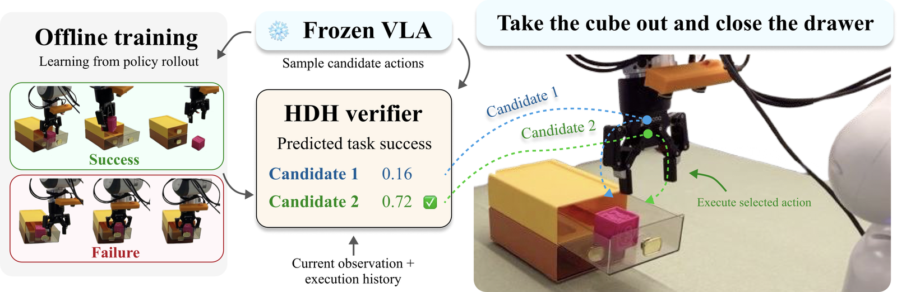
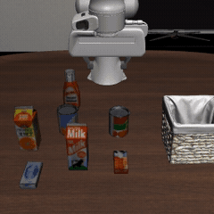
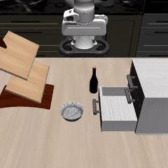
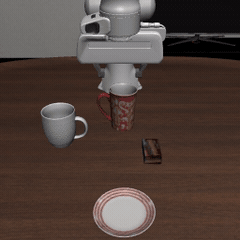
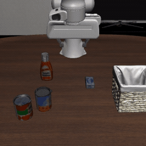

# Learning Low-Latency Action Verification for Frozen Vision-Language-Action Models

Wen-Han Hsieh<sup>1</sup>, Ken Jiankun Zheng<sup>1</sup>, Chia-Chien Chen<sup>2</sup>, David Chan<sup>1</sup>, Trevor Darrell<sup>1</sup><br>
<sup>1</sup>UC Berkeley, <sup>2</sup>National Tsing Hua University



This repository contains the simulation (LIBERO) code of **HDH**. For real-robot deployment on DROID, see [hdh_real](https://github.com/Wen-HanHsieh/hdh_real).

## Introduction

HDH improves a frozen VLA by choosing which of its own sampled actions to execute. The method has three stages.
1. Deploy the frozen policy and collect autonomous rollouts with their terminal success or failure.
2. Train a compact verifier that assigns each action chunk a predicted task-success score. Every query of an episode is labeled with that episode's outcome.
3. At each query, sample K=2 action chunks from the frozen VLA and execute the first H=8 actions of the highest-scoring one.


The verifier reads the policy's own SigLIP prefix tokens, the proprioceptive state and the candidate's executed prefix. HDM uses the current observation only. HDH adds a GRU summary of the three preceding queries.

<table>
<tr>
<td align="center"><br><sub>Soup + Sauce into Basket</sub></td>
<td align="center"><br><sub>Bowl into Drawer + Close</sub></td>
<td align="center"><br><sub>Mug on Plate + Pudding to Right</sub></td>
<td align="center"><br><sub>Soup + Cheese into Basket</sub></td>
</tr>
</table>

## Installation

The policy runs in the [openpi](https://github.com/Physical-Intelligence/openpi) (JAX) environment. Simulation and the verifier run in a PyTorch environment with [LIBERO](https://github.com/Lifelong-Robot-Learning/LIBERO). The two talk over a unix socket.

```bash
git clone https://github.com/Wen-HanHsieh/hdh_sim.git && cd hdh_sim
export PYTHONPATH=$PWD

# JAX environment
git clone --recurse-submodules https://github.com/Physical-Intelligence/openpi.git
(cd openpi && GIT_LFS_SKIP_SMUDGE=1 uv sync)
python scripts/add_config.py --openpi openpi

# PyTorch environment: install LIBERO, then
pip install -r requirements.txt
```

## Step 1: Fine-tune the Policy

We fine-tune π0.5 with LoRA on 50 public LIBERO demonstrations, ten from each of five LIBERO-10 tasks. The episodes are pinned in `benchmark/finetune_episodes.json` and verified by checksum.

```bash
openpi/.venv/bin/python scripts/build_dataset.py
cd openpi
uv run scripts/compute_norm_stats.py --config-name pi05_libero_hdh
uv run scripts/train.py pi05_libero_hdh --exp-name hdh
```

The policy stays frozen from here on. Set `POLICY=openpi/checkpoints/pi05_libero_hdh/hdh/4999`.

## Step 2: Serve the Policy

```bash
openpi/.venv/bin/python -m hdh.server /tmp/pi.sock pi05_libero_hdh $POLICY
```

Keep one server running for every step below. All methods of a comparison must share it, because π0.5 samples differ slightly across server restarts.

## Step 3: Collect Rollouts

Roll out the frozen policy on 100 training states per task. Twenty episodes are held out for validation. Training states are disjoint from the evaluation states in `benchmark/eval_states`.

```bash
for t in 0 3 6 7; do python scripts/collect.py --task_id $t --sock /tmp/pi.sock --out data; done
```

## Step 4: Train the Verifier

Train one verifier per task. Omit `--history` to train HDM.

```bash
NORM=$POLICY/assets/hdh/libero_10/norm_stats.json
for t in 0 3 6 7; do for s in 0 1 2; do
  python scripts/train.py --data data/libero_10_$t --norm_stats $NORM --history --seed $s \
      --out checkpoints/libero_10_${t}_hdh_s$s.pt
done; done
```

## Step 5: Evaluate

Each run evaluates 50 held-out states per task. We use three runs, each with a separately trained verifier.

```bash
for r in 0 1 2; do for t in 0 3 6 7; do
  python scripts/eval.py --task_id $t --sock /tmp/pi.sock --run $r --arm baseline
  python scripts/eval.py --task_id $t --sock /tmp/pi.sock --run $r --arm random
  python scripts/eval.py --task_id $t --sock /tmp/pi.sock --run $r --arm hdh --ckpt checkpoints/libero_10_${t}_hdh_s$r.pt
done; done
python scripts/analyze.py --runs runs
```

`analyze.py` reports success per task as mean ± std over runs, the unweighted average, and end-to-end time per query.

## Results

Success rate (%) on four LIBERO-10 tasks and time per policy query on one H100.

| Method | Soup + Sauce | Bowl + Drawer | Mug + Pudding | Soup + Cheese | Average | p50 (ms) |
| --- | :-: | :-: | :-: | :-: | :-: | :-: |
| Baseline | 73.3 ± 2.5 | 96.0 ± 0.0 | 66.0 ± 2.8 | 80.0 ± 4.3 | 78.8 | 681 |
| Random | 64.0 ± 2.8 | 95.3 ± 0.9 | 66.7 ± 6.6 | 84.0 ± 4.9 | 77.5 | 692 |
| GPT-5 | 73.3 | 93.3 | 73.3 | 73.3 | 78.3 | 27,674 |
| GPT-6 | 69.3 ± 6.6 | 96.7 ± 0.9 | 72.0 ± 7.5 | 84.7 ± 2.5 | 80.7 | 7,403 |
| HDM | 70.0 ± 3.3 | 98.7 ± 0.9 | 66.7 ± 8.4 | 86.0 ± 4.3 | 80.3 | 716 |
| **HDH (Ours)** | **76.7 ± 2.5** | 97.3 ± 2.5 | 72.0 ± 5.9 | 83.3 ± 5.0 | **82.3** | 718 |

The VLM verifier baselines are not part of this repository.

## Acknowledgement

This repository builds on [openpi](https://github.com/Physical-Intelligence/openpi) and [LIBERO](https://github.com/Lifelong-Robot-Learning/LIBERO).

## Citation

```bibtex
@article{hsieh2026hdh,
  title   = {Learning Low-Latency Action Verification for Frozen Vision-Language-Action Models},
  author  = {Hsieh, Wen-Han and Zheng, Ken Jiankun and Chen, Chia-Chien and Chan, David and Darrell, Trevor},
  journal = {arXiv preprint},
  year    = {2026}
}
```
